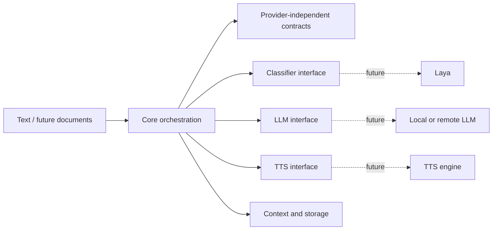
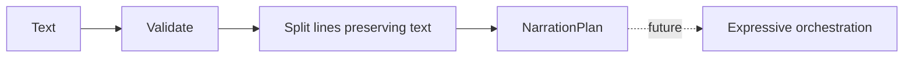
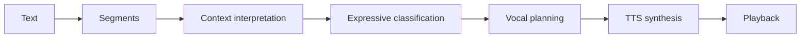
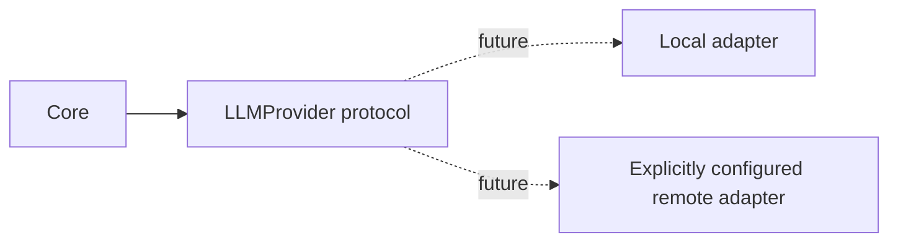
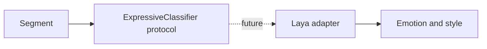
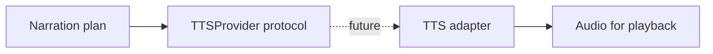
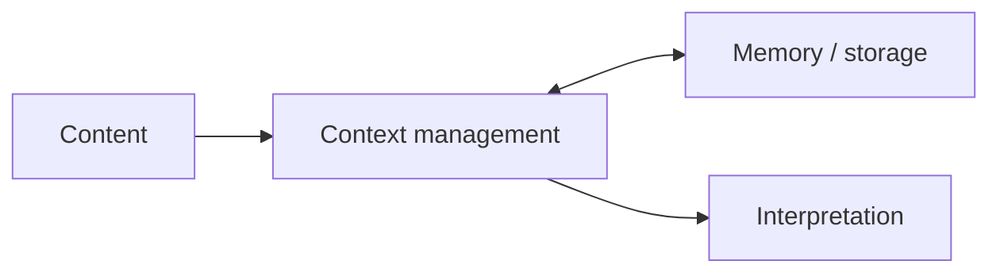
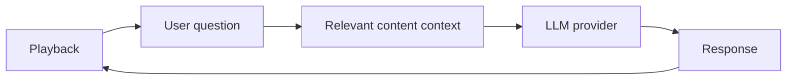
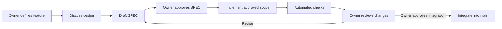

# Architecture

The implemented bootstrap consists of `TextService`, provider-independent data contracts, protocols and explicit settings. The following diagrams show the intended direction and are **proposals**, except for the existing text service and interfaces. No prior architecture reference was found. Arrows indicate conceptual flow, not implemented integrations or approved internal dependencies.

## 1. General architecture

## 2. Core internals

## 3. Expressive narration

Only text segmentation exists today.

## 4. Interchangeable LLMs

## 5. Expressive classification with Laya

Laya is the intended initial classifier; neither adapter nor integration exists yet. Speaker identification remains future work.

## 6. TTS adaptation

The current protocol accepts a text segment and returns bytes; audio encoding and expressive mapping are undecided.

## 7. Memory and context

Scope, persistence, retention and interfaces are undecided.

## 8. Conversation during playback

Playback interruption and resumption behavior remain undecided.

## 9. SDD workflow

## 10. Implemented content ingestion (SPEC-002)

The content service and importers are separate from `TextService` and provider contracts. Importers only parse local bytes. Format-specific extraction cannot guarantee layout or byte-for-byte fidelity of an EPUB, PDF or DOCX. See [SPEC-002](../specs/SPEC-002-content-ingestion.md) for exact behavior and limitations. Other diagrams above describe future narration work, not an implemented pipeline.
